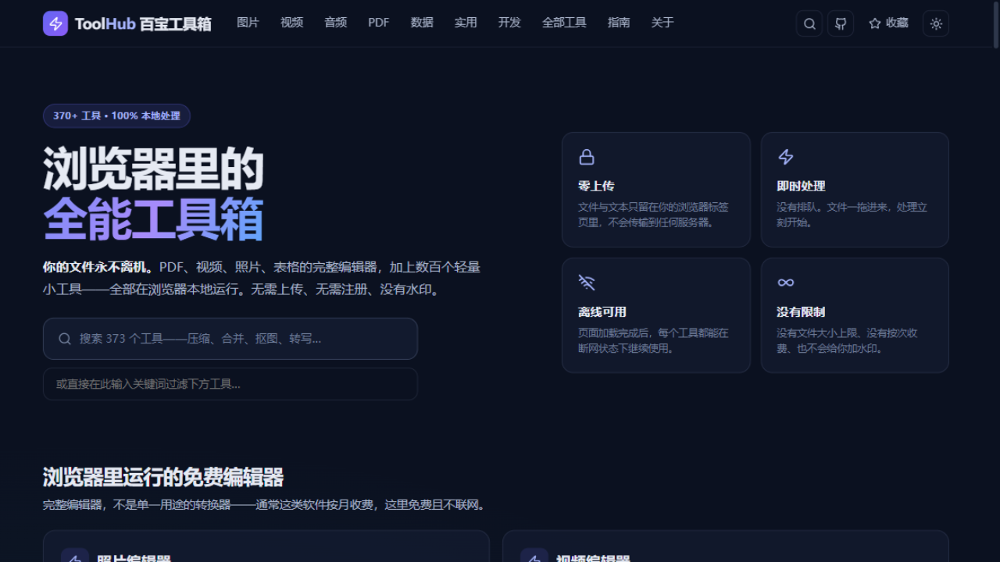
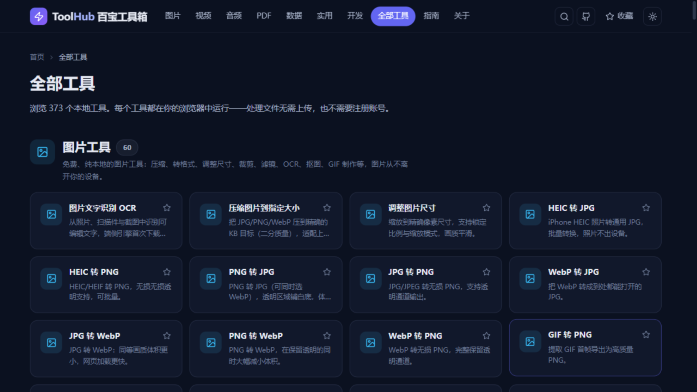
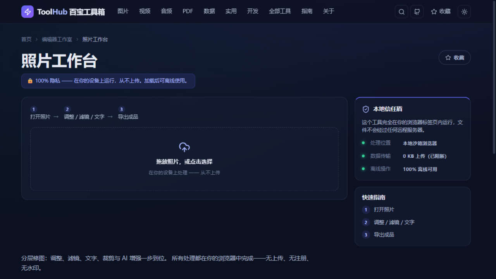
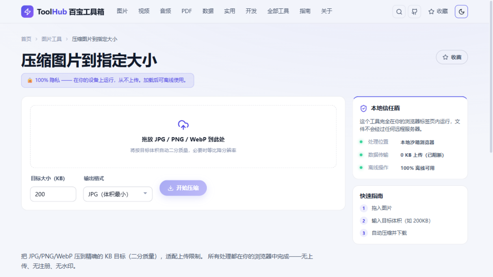

<div align="center">

# 百宝工具箱 ToolHub

> **你的文件，永不离机** —— 520 个纯浏览器端工具，聚合一页。

[](LICENSE)
[](https://vuejs.org)
[](https://www.typescriptlang.org)
[](https://vite.dev)
[](#-工具分类)

图片 · 视频 · 音频 · PDF · 数据 · 开发 · 金融 · SEO · 端侧 AI —— **全部在你的浏览器本地运行，文件永不上传。**

</div>

---

独立实现、可私有部署的纯前端工程：无后端、无 Node 运行时依赖，构建产物为纯静态文件，可部署于任意支持 SPA 回退的静态托管（EdgeOne Pages、Cloudflare Pages 等——history 路由要求所有路径回退到 index.html）。

## 🖼️ 界面预览

| **首页**<br> | **全部工具**<br> |
|:---:|:---:|
| **照片工作台**<br> | **工具页 · 浅色主题**<br> |

## ✨ 特性

- **🔒 零上传** —— 文件与文本只留在浏览器标签页中，不向任何服务器传输。
- **⚡ 即时处理** —— 没有排队，文件拖进来处理立刻开始。
- **📶 离线可用** —— 页面加载完成后，每个工具都能在断网状态下继续使用。
- **♾️ 无限制** —— 没有文件大小上限、没有按次收费、不会加水印。
- **🪶 按需加载** —— 重依赖（PDF、ffmpeg、OCR、图表等）全部动态导入，首屏只保留 Vue / 路由 / 样式。
- **🌗 明暗双主题** —— 手写设计系统，CSS 变量令牌驱动。

## 🧰 工具分类

| 分类 | 工具数 | 代表能力 |
|---|---:|---|
| 图片工具 | 73 | 压缩、转格式、调整尺寸、裁剪、滤镜、OCR、抠图、GIF 制作 |
| 实用工具 | 135 | 二维码、密码生成、单位换算、各类计算器、文本处理 |
| 开发工具 | 92 | JSON 格式化、哈希、Base64、JWT、正则测试、TOTP/加密 |
| PDF 工具 | 54 | 合并、拆分、加密、页码、水印、转图片、转 Office |
| 视频工具 | 42 | 压缩到指定大小、MP4/WebM/MOV 转换、裁剪合并、变速、抽帧、转 GIF |
| 音频工具 | 38 | MP3/WAV/M4A/FLAC 转换、压缩、降噪、变调、白噪音、调音器 |
| 金融交易 | 20 | 期权定价、仓位管理、IRR/NPV、还款计划表等计算器（附计算口径） |
| 商业 SaaS | 16 | LTV、CAC、流失率、MRR/ARR、留存热力图、简历生成器 |
| SEO 工具 | 13 | JSON-LD 结构化数据、hreflang、站点地图、搜索结果预览、关键词分析 |
| AI 工具 | 15 | 端侧 AI：摘要、情感分析、关键词、翻译、OCR、抠图、图像分类（本地推理） |
| 数据工具 | 18 | 浏览器内分析 CSV / Excel / Parquet / SQLite：SQL 查询、透视、图表、对比 |
| 编辑器工作室 | 4 | PDF 工作台、视频工作台、照片工作台、数据工作台 |
| **合计** | **520** | |

## 🚀 快速开始

环境要求：Node.js ≥ 18（推荐 20+）。

```bash
npm install
npm run dev        # 开发服务器 http://localhost:5173
npm run typecheck  # 类型检查（vue-tsc）
npm run build      # 类型检查 + 构建 → dist/（纯静态产物）
npm run preview    # 本地预览构建产物
```

## 🏗️ 技术栈

| 层 | 选型 |
|---|---|
| 框架 | Vue 3.5（`<script setup>` 组合式 API） |
| 语言 | TypeScript（strict） |
| 构建 | Vite 6 |
| 路由 | Vue Router 4（hash 模式，纯静态可部署） |
| 样式 | 手写设计系统（CSS 变量令牌，明暗双主题） |
| PDF | @cantoo/pdf-lib（读写+加密）、pdfjs-dist（渲染/文本） |
| 表格 | papaparse、SheetJS(xlsx)、hyparquet（Parquet） |
| 图表 | Chart.js |
| 音频 | Web Audio API + @breezystack/lamejs（MP3 编码） |
| 视频 | @ffmpeg/ffmpeg（wasm，按需懒加载，约 30MB） |
| 图像 | 原生 Canvas 引擎（零依赖）+ heic2any / utif 解码 |
| 端侧 AI | tesseract.js（OCR）、onnxruntime-web（推理） |
| 图标 | lucide-vue-next |
| 富文本 | marked + DOMPurify（Markdown 预览） |

## 📐 架构设计

```
src/
  lib/          20 个共享引擎（图像/PDF/音频/视频/文本/NLP/金融…）
  tools/        11 个分类注册表 + 工具组件（每个工具一个文件）
  components/   通用 UI（FileDrop/ResultBox/CalcTool/TextTool…）
  pages/        首页/分类页/工具页/收藏/指南/关于…
  data/         分类与站点配置、指南内容
  composables/  useSaved（收藏）/useTheme/useSearch/useToast
```

核心设计：**注册表驱动**。每个工具在分类 `registry.ts` 中声明元数据与实现方式（自定义组件 / 内联文本转换 / 内联计算器 / 通用格式转换配置），工具页按声明渲染；共享引擎承担全部重逻辑，工具组件只做输入交互。

- 路由为 hash 模式 + `base: './'`，产物可放任意静态目录，无需服务器 rewrite 配置。
- 首次使用需下载模型/编解码器的工具（OCR、抠图、转写、ffmpeg）标注 `needModel`，界面显示明确下载提示；下载后浏览器缓存，可离线使用。
- 收藏 / 主题等偏好保存在 localStorage。

## 📦 部署

`npm run build` 产出 `dist/` 纯静态文件，可部署到任意静态托管（GitHub Pages、Cloudflare Pages、Netlify、Vercel、Nginx 等）：

```bash
npm run build
# 将 dist/ 目录内容发布到任意静态托管即可
```

history 路由要求宿主支持 SPA 回退（Cloudflare Pages / Netlify / Vercel 默认支持；Nginx 需配 `try_files ... /index.html`）。

## 🧑‍💻 开发

新增一个工具通常只需两步：在对应分类的 `registry.ts` 中注册 `ToolDef`，再提供一个懒加载组件（或复用通用 TextTool / CalcTool / ImageConvertTool 实现）。完整契约见 `docs/基础设计规约.md`。

| 文档 | 内容 |
|---|---|
| [docs/基础设计规约.md](docs/基础设计规约.md) | 唯一全版本规约：产品定位、信息架构、视觉体系、工程契约（注册表格式、实现模式、引擎 API） |
| [docs/V1.1/](docs/V1.1/) | 当前版本基线（520 项）：需求文档、设计文档、工具清单、依赖清单 |
| [docs/V1.0/](docs/V1.0/) | 上一版本基线（402 项）快照，只读留档 |

提交前请确保 `npm run typecheck` 通过（`npm run build` 自带类型检查）。

## 📄 License

[MIT](LICENSE)（本项目自有代码）。第三方依赖的许可见 [docs/V1.1/依赖清单-V1.1.md](docs/V1.1/依赖清单-V1.1.md)。
